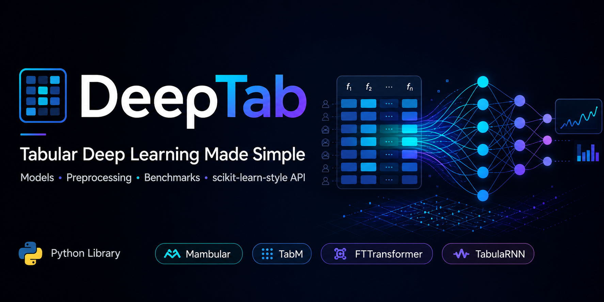

<div align="center">
    

[](https://pypi.org/project/deeptab)

[](https://pypi.org/project/deeptab)
[](https://github.com/OpenTabular/DeepTab/blob/main/LICENSE)
[](https://deeptab.readthedocs.io/en/latest/)
[](https://github.com/OpenTabular/DeepTab/issues)

[📘 Documentation](https://deeptab.readthedocs.io) |
[🚀 Getting Started](https://deeptab.readthedocs.io/en/latest/getting_started/quickstart.html) |
[🎯 Model Zoo](https://deeptab.readthedocs.io/en/latest/model_zoo/index.html) |
[📖 Tutorials](https://deeptab.readthedocs.io/en/latest/tutorials/index.html) |
[🤔 Report Issues](https://github.com/OpenTabular/DeepTab/issues)

</div>

# DeepTab: Tabular Deep Learning Made Simple

**DeepTab** is a Python library for deep learning on tabular data, built on PyTorch and Lightning with a scikit-learn compatible API. It offers 15 neural architectures, from Mamba-inspired state space models and Transformers to tree ensembles and MLP baselines, each available as a classifier, regressor, or distributional (`LSS`) model. One `fit`/`predict`/`evaluate` workflow covers everyday modeling, architecture research, and production deployment.

## Why DeepTab?

- **Familiar interface.** A scikit-learn `fit`/`predict`/`evaluate` API that drops into existing pipelines, including `GridSearchCV`.
- **Automatic preprocessing.** Feature-type detection, encoding, scaling, and missing-value handling are powered by [PreTab](https://github.com/OpenTabular/PreTab) and applied for you.
- **One model, three tasks.** Every architecture ships as a classifier, a regressor, and a distributional (`LSS`) variant for uncertainty quantification.
- **A broad model zoo.** 15 stable architectures plus experimental models, all behind the same interface, with [selection guidance](https://deeptab.readthedocs.io/en/latest/model_zoo/index.html).
- **Built for real data.** Mixed feature types, class imbalance, GPU acceleration, and early stopping work out of the box.

## What's New in v2.1

v2.1 updates preprocessing to PreTab 1.0 and improves estimator, architecture, and persistence behavior.

- **Python support:** Python 3.11-3.13; Python 3.10 is no longer supported. Recreate older environments before upgrading.
- **Dependency security:** patched Torch, setuptools, Lightning, and Accelerate requirements; native TabR dependencies now use the separate `tabr` extra on Linux and Windows.
- **Preprocessing:** canonical `numerical_method`, `categorical_method`, and `output_dim` fields, native PreTab presets, and a default requested width of 7. Effective widths depend on the representation and fitted data; B-splines cap a request of 64 at 50 columns.
- **Model correctness:** fixes for normalization, activations, attention, recurrent state, repeatable `encode()` calls, and ensemble LSS output shapes.
- **Estimator reliability:** improved cloning, fitted-state checks, class-label handling, validation, and CPU artifact reloads.
- **Release checks:** publication requires passing CI, documentation, installed-wheel training and reload checks, and at least 90% line coverage.

See the [Numerical Width Study](https://deeptab.readthedocs.io/en/latest/model_zoo/efficiency.html#numerical-width-study) for a small CPU comparison of preprocessing widths, including the protocol, runner, and raw results.

> **Upgrading?** See the [Migration Guide](https://deeptab.readthedocs.io/en/latest/getting_started/migration.html) for configuration changes and historical artifact limitations. Tested 2.0 PLE artifacts require their original dependency environment; upgrading does not convert them.

## 🏃 Quickstart

```python
from deeptab.models import MambularClassifier

# Initialize and fit (sklearn-compatible)
model = MambularClassifier()
model.fit(X_train, y_train, max_epochs=50)

# Predict
predictions = model.predict(X_test)
probabilities = model.predict_proba(X_test)
```

> **That's it!** DeepTab handles preprocessing, batching, and training automatically.

> **Works with pandas & numpy:** Pass DataFrames or arrays, and DeepTab auto-detects feature types.

## Available Models

DeepTab provides 15 stable architectures across five families: State Space Models (Mambular, MambaTab, MambAttention), Transformers (FTTransformer, TabTransformer, SAINT, AutoInt), residual networks (ResNet, TabR), tree-inspired models (NODE, ENODE, NDTF), and general baselines (MLP, TabM, TabulaRNN). Three experimental models (ModernNCA, Tangos, Trompt) are under evaluation for promotion.

> **See the [Model Zoo](https://deeptab.readthedocs.io/en/latest/model_zoo/index.html) for detailed comparisons, complexity analysis, and selection guidance.**

### Stable Models

| Category               | Model                                      | Architecture                        | Best For                               |
| ---------------------- | ------------------------------------------ | ----------------------------------- | -------------------------------------- |
| **State Space Models** | **[Mambular][mambular-paper]**             | Stacked Mamba over feature tokens   | General-purpose tabular modeling       |
|                        | **[MambaTab][mambatab-paper]**             | Lightweight Mamba SSM               | Small datasets and fast training       |
|                        | **MambAttention**                          | Mamba with feature attention        | Feature-interaction-heavy data         |
| **Transformers**       | **[FTTransformer][fttransformer-paper]**   | Feature Tokenizer + Transformer     | Strong attention-based baseline        |
|                        | **[TabTransformer][tabtransformer-paper]** | Transformer over categorical tokens | Categorical-heavy data                 |
|                        | **[SAINT][saint-paper]**                   | Row and column attention            | Small or label-scarce datasets         |
|                        | **[AutoInt][autoint-paper]**               | Self-attentive feature interactions | Automatic high-order interactions      |
| **Residual Networks**  | **[ResNet][resnet-paper]**                 | Residual MLP                        | Fast dense baseline                    |
|                        | **[TabR][tabr-paper]**                     | Retrieval-augmented MLP/kNN         | Large datasets with neighbor signal    |
| **Tree-Inspired**      | **[NODE][node-paper]**                     | Neural oblivious decision ensembles | Differentiable tree inductive bias     |
|                        | **ENODE**                                  | Embedded NODE-style soft trees      | Tree-inspired modeling with embeddings |
|                        | **[NDTF][ndtf-paper]**                     | Neural decision tree forest         | Differentiable forest experiments      |
| **Other**              | **MLP**                                    | Feedforward dense network           | Fastest baseline                       |
|                        | **[TabM][tabm-paper]**                     | Parameter-efficient ensemble MLP    | Strong efficient baseline              |
|                        | **TabulaRNN**                              | Recurrent feature-sequence model    | Sequential feature modeling            |

[mambular-paper]: https://arxiv.org/abs/2408.06291
[mambatab-paper]: https://arxiv.org/abs/2401.08867
[fttransformer-paper]: https://arxiv.org/abs/2106.11959
[resnet-paper]: https://arxiv.org/abs/2106.11959
[tabtransformer-paper]: https://arxiv.org/abs/2012.06678
[saint-paper]: https://arxiv.org/abs/2106.01342
[autoint-paper]: https://arxiv.org/abs/1810.11921
[tabr-paper]: https://arxiv.org/abs/2307.14338
[node-paper]: https://arxiv.org/abs/1909.06312
[ndtf-paper]: https://openaccess.thecvf.com/content_iccv_2015/html/Kontschieder_Deep_Neural_Decision_ICCV_2015_paper.html
[tabm-paper]: https://arxiv.org/abs/2410.24210

### Experimental Models ⚠️

> **⚠️ API Not Stable:** Experimental models may change in minor releases. Always pin exact version: `deeptab==x.y.z`

- **ModernNCA**: Neighborhood Component Analysis (metric learning)
- **Tangos**: Gradient orthogonalization approach
- **Trompt**: Prompt-based learning for tabular data

### Task Variants

All models come in three variants:

- `*Classifier`: Classification (binary & multi-class)
- `*Regressor`: Regression (point estimates)
- `*LSS`: Distributional regression (full distribution prediction)

> **Consistent API:** All models use the same interface, so you can swap architectures without changing code.

## 📚 Documentation

**Full documentation:** [deeptab.readthedocs.io](https://deeptab.readthedocs.io)

### Quick Links

- **[Getting Started](https://deeptab.readthedocs.io/en/latest/getting_started/index.html)**: Installation, quickstart, FAQ
- **[Core Concepts](https://deeptab.readthedocs.io/en/latest/core_concepts/index.html)**: sklearn API, config system, preprocessing, training
- **[Tutorials](https://deeptab.readthedocs.io/en/latest/tutorials/index.html)**: Classification, regression, LSS (with Google Colab)
- **[Model Zoo](https://deeptab.readthedocs.io/en/latest/model_zoo/index.html)**: Model selection, comparisons, recommended configs
- **[API Reference](https://deeptab.readthedocs.io/en/latest/api/index.html)**: Complete API documentation

## 🛠️ Installation

**Basic installation:**

```bash
pip install deeptab
```

**With experiment tracking and structured logging:**

```bash
pip install 'deeptab[tracking]'   # MLflow + TensorBoard loggers
pip install 'deeptab[logs]'       # structured logging via structlog
pip install 'deeptab[all]'        # all logging and tracking backends
pip install 'deeptab[tabr]'       # native TabR retrieval on Linux or Windows
```

**Optional native Mamba backend:**

```bash
pip install mamba-ssm
```

> **Mamba backends:** The default `mamba_version="mamba-torch"` uses DeepTab's pure-PyTorch implementation. Installing `mamba-ssm` does not change that selection. For Mambular, explicitly select `MambularConfig(mamba_version="mamba1")` or `"mamba2"` and meet the [upstream GPU and build requirements](https://github.com/state-spaces/mamba#installation). An explicitly selected native backend does not silently fall back if its dependencies are missing or incompatible; performance depends on the workload and hardware.

> **Optional dependencies:** Logging, tracking, and TabR retrieval dependencies are loaded lazily. The default installation does not include `faiss-cpu` or `delu`. The `all` extra bundles observability backends only; combine extras explicitly, for example `deeptab[all,tabr]`, on a supported native platform.

> **Requirements:** Python 3.11-3.13, PyTorch >=2.13,<2.15, PreTab 1.x, Lightning >=2.6.6,<3.0. See the [Support Matrix](https://deeptab.readthedocs.io/en/latest/developer_guide/support_matrix.html) for dependency and platform constraints.

> **macOS:** Python 3.13 PyTorch wheels are available for Apple Silicon. Intel Macs are outside the CI matrix. Native TabR is unsupported on Apple Silicon because Torch and the PyPI FAISS build load conflicting OpenMP runtimes; use Linux or Windows for TabR.

> **GPU Support:** See [installation guide](https://deeptab.readthedocs.io/en/latest/getting_started/installation.html) for CUDA setup.

## Usage

### Basic Workflow

```python
from deeptab.models import MambularClassifier
from deeptab.configs import MambularConfig, PreprocessingConfig, TrainerConfig

# 1. Initialize with configuration (optional - defaults work well!)
model_config = MambularConfig(d_model=64, n_layers=6)
prep_config = PreprocessingConfig(numerical_method="quantile")
trainer_config = TrainerConfig(lr=1e-4, batch_size=256)

model = MambularClassifier(
    model_config=model_config,
    preprocessing_config=prep_config,
    trainer_config=trainer_config
)

# 2. Fit (X can be pandas DataFrame or numpy array)
model.fit(X_train, y_train, max_epochs=50)

# 3. Predict
predictions = model.predict(X_test)
probabilities = model.predict_proba(X_test)

# 4. Evaluate
metrics = model.evaluate(X_test, y_test)
# Regression:      {"rmse": …, "mae": …, "r2": …}
# Classification:  {"accuracy": …, "auroc": …, "log_loss": …}
# LSS (normal):    {"crps": …, "rmse": …, "mae": …}
```

> **💡 Tip:** Start with defaults (`MambularClassifier()`) and tune only if needed. See [Recommended Configs](https://deeptab.readthedocs.io/en/latest/model_zoo/recommended_configs.html) for guidance.

### Hyperparameter Tuning

DeepTab models support `GridSearchCV`. Supply explicit configs before tuning nested parameters:

```python
from sklearn.model_selection import GridSearchCV
from deeptab.configs import MambularConfig, TrainerConfig
from deeptab.models import MambularClassifier

param_grid = {
    "model_config__d_model": [64, 128, 256],
    "model_config__n_layers": [4, 6, 8],
    "trainer_config__lr": [1e-4, 5e-4, 1e-3],
}

search = GridSearchCV(
    MambularClassifier(model_config=MambularConfig(), trainer_config=TrainerConfig()),
    param_grid,
    cv=5,
    scoring="accuracy"
)
search.fit(X_train, y_train)
print(f"Best params: {search.best_params_}")
print(f"Best score: {search.best_score_}")
```

> **Built-in HPO:** Every estimator exposes `optimize_hparams()`, which runs Gaussian process Bayesian optimization (via [scikit-optimize](https://scikit-optimize.github.io/)) over a search space derived from the model config. See the [HPO Tutorial](https://deeptab.readthedocs.io/en/latest/tutorials/hpo.html).

### Distributional Regression (LSS)

Predict a full distribution instead of a single point estimate:

```python
from deeptab.models import MambularLSS

# Choose a distribution family when you fit
model = MambularLSS()
model.fit(X_train, y_train, family="normal", max_epochs=50)

# predict() returns the estimated distribution parameters per sample
# (for "normal", that is the location and scale)
params = model.predict(X_test)

# Evaluate with proper scoring rules selected for the family
metrics = model.evaluate(X_test, y_test)
```

> **Available families:** `normal`, `lognormal`, `studentt`, `gamma`, `beta`, `tweedie`, `poisson`, `zip`, `negativebinom`, `dirichlet`, `mog`, `quantile`, and more. Each family auto-selects appropriate evaluation metrics (CRPS, deviances, NLL).

> **Prediction intervals:** Turn the predicted parameters into calibrated intervals as shown in the [Uncertainty Quantification tutorial](https://deeptab.readthedocs.io/en/latest/tutorials/uncertainty_quantification.html).

## Advanced Features

### Preprocessing

DeepTab includes comprehensive preprocessing powered by [PreTab](https://github.com/OpenTabular/PreTab):

```python
from deeptab.configs import PreprocessingConfig
from deeptab.models import MambularClassifier

prep_config = PreprocessingConfig(
    numerical_method="ple",
    output_dim=20,
)

model = MambularClassifier(preprocessing_config=prep_config)
model.fit(X_train, y_train, max_epochs=50)
```

> **Features:**
>
> - **Automatic detection:** Feature types detected from data
> - **Type-aware:** Separate strategies for numerical and categorical features
> - **Methods:** PLE, quantile transform, splines, standardization, min-max, and robust scaling
> - **Pre-trained encodings:** Transfer learning for categorical features

> **Learn more:** Preprocessing is driven by `PreprocessingConfig`; see the [Config System](https://deeptab.readthedocs.io/en/latest/core_concepts/config_system.html) guide and the [PreTab](https://github.com/OpenTabular/PreTab) project.

> **Note:** Duplicate column names raise a `DuplicateColumnsError`, and a training column that is entirely missing is imputed with a constant rather than passed through untouched. See the [FAQ](https://deeptab.readthedocs.io/en/latest/getting_started/faq.html#data-and-preprocessing) for details.

### Observability & Experiment Tracking

DeepTab can record what happens during training without you writing any callbacks. Pass an `ObservabilityConfig` when you build a model, and each run captures its hyperparameters, lifecycle events, and final metrics in one self-contained folder.

```python
from deeptab.core.observability import ObservabilityConfig
from deeptab.models import MambularClassifier

obs = ObservabilityConfig(
    experiment_name="churn_baseline",
    structured_logging=True,                       # human-readable lifecycle events on the console
    log_to_file=True,                              # also write them to lifecycle.jsonl per run
    experiment_trackers=["mlflow", "tensorboard"],
)

model = MambularClassifier(observability_config=obs)
model.fit(X_train, y_train, max_epochs=50)
```

Every fit produces a tidy, reproducible run directory:

```text
deeptab_runs/
  runs/churn_baseline/20260611_174830_8f3a2c/
    config.yaml       # estimator hyperparameters
    lifecycle.jsonl   # structured event log
    summary.json      # final metrics
    checkpoints/best_model.ckpt
  tensorboard/...
  mlflow/...
```

> **Tune the noise:** `verbosity` controls how much is emitted (`0` silent, `1` milestones, `2` detailed, `3` debug). The default keeps notebooks quiet.

> **🔬 For researchers:** Lifecycle events such as `fit.started`, `model.created`, and `train.completed` carry structured metadata (sample counts, parameter counts, best validation loss), so you can script experiment sweeps and compare runs programmatically.

> **📖 Learn more:** [Observability](https://deeptab.readthedocs.io/en/latest/core_concepts/observability.html)

### Custom Models

Implement your own architecture with DeepTab's base classes. A model is three
small pieces: a dataclass **config** (subclassing `BaseModelConfig`), a PyTorch
**architecture** (subclassing `BaseModel`), and one **estimator** per task that
binds them via `_model_cls` / `_config_cls`:

```python
from dataclasses import dataclass, field

import torch
import torch.nn as nn

from deeptab.configs import BaseModelConfig, TrainerConfig
from deeptab.core import BaseModel, get_feature_dimensions
from deeptab.models import SklearnBaseRegressor


@dataclass
class MyCustomConfig(BaseModelConfig):
    layer_sizes: list = field(default_factory=lambda: [128, 64])
    dropout: float = 0.1


class MyCustomModel(BaseModel):
    def __init__(
        self,
        feature_information: tuple,  # (num_info, cat_info, embedding_info)
        num_classes: int = 1,
        config: MyCustomConfig = MyCustomConfig(),  # noqa: B008
        **kwargs,
    ):
        super().__init__(config=config, **kwargs)
        self.save_hyperparameters(ignore=["feature_information"])

        # Input width is derived from the data, never hard-coded.
        input_dim = get_feature_dimensions(*feature_information)

        layers: list[nn.Module] = []
        prev = input_dim
        for size in self.hparams.layer_sizes:
            layers += [nn.Linear(prev, size), nn.ReLU(), nn.Dropout(self.hparams.dropout)]
            prev = size
        layers.append(nn.Linear(prev, num_classes))
        self.layers = nn.Sequential(*layers)

    def forward(self, *data) -> torch.Tensor:
        # data == (num_features, cat_features, embeddings)
        x = torch.cat([t for group in data for t in group], dim=1)
        return self.layers(x)


class MyRegressor(SklearnBaseRegressor):
    _model_cls = MyCustomModel
    _config_cls = MyCustomConfig


# Use like any other DeepTab model
model = MyRegressor(
    model_config=MyCustomConfig(layer_sizes=[256, 128]),
    trainer_config=TrainerConfig(lr=1e-3),
)
model.fit(X_train, y_train, max_epochs=50)
```

> **📖 Learn more:** [Custom Models](https://deeptab.readthedocs.io/en/latest/core_concepts/custom_models.html) walks through configs, embeddings, and the `*Classifier` / `*Regressor` / `*LSS` variants.

> **🛠️ Developer Guide:** See [Contributing](https://deeptab.readthedocs.io/en/latest/developer_guide/contributing.html) for architecture guidelines.

## 🏷️ Citation

If you use DeepTab in your research, please cite:

```bibtex
@article{thielmann2024mambular,
  title={Mambular: A Sequential Model for Tabular Deep Learning},
  author={Thielmann, Anton Frederik and Kumar, Manish and Weisser, Christoph and Reuter, Arik and S{\"a}fken, Benjamin and Samiee, Soheila},
  journal={arXiv preprint arXiv:2408.06291},
  year={2024}
}

@article{thielmann2024efficiency,
  title={On the Efficiency of NLP-Inspired Methods for Tabular Deep Learning},
  author={Thielmann, Anton Frederik and Samiee, Soheila},
  journal={arXiv preprint arXiv:2411.17207},
  year={2024}
}
```

## 📄 License

DeepTab is licensed under the MIT License. See [LICENSE](LICENSE) for details.

## 🤝 Contributing

Contributions are welcome. See the [Contributing Guide](https://deeptab.readthedocs.io/en/latest/developer_guide/contributing.html) to get started, and please follow our [Code of Conduct](https://github.com/OpenTabular/DeepTab/blob/main/CODE_OF_CONDUCT.md).

## 📞 Support

- **Issues:** [GitHub Issues](https://github.com/OpenTabular/DeepTab/issues)
- **Discussions:** [GitHub Discussions](https://github.com/OpenTabular/DeepTab/discussions)
